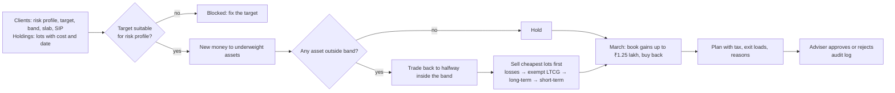

# BalanceBook


**Tax-aware portfolio rebalancing for Indian advisers: keep every client inside their agreed allocation while paying a fraction of the tax, with a plan the adviser approves before anything is traded.**

Rebalancing protects a client from drifting into risk they never agreed to. Done the usual way (sell back to target every year, or whenever a band is crossed, oldest units first) it also realises short-term gains taxed at 20%, triggers 1% exit loads and burns the ₹1.25 lakh yearly exemption on long-term gains. BalanceBook does the same risk job differently: new SIP money goes to whatever is underweight, it trades only when a client leaves their band and only back to halfway inside, it sells the lots that cost least in tax and exit load, and in March it books tax-free gains up to the exemption so the cost basis rises every year.

## Results

`python -m balancebook.backtest` runs ten years of monthly prices for equity, debt and gold funds and 300 client books (conservative, moderate, aggressive; ₹20 lakh to ₹2 crore; monthly SIPs; existing lots bought over earlier years). Every strategy sees the same clients and the same market. Tax follows current Indian rules and is settled every financial year; at the end everything is sold so after-tax wealth is comparable. The **held-out** run has a different market (two crashes, 30% higher volatility) and a different client mix, and was not used for tuning.

| Strategy (average per client) | Distance from target, dev / held-out | Months outside the 5-point band | Tax + exit loads paid | After-tax wealth at the end |
|---|---|---|---|---|
| Never rebalance | 12.9% / 12.4% | 86% / 87% | ₹0 / ₹0 | ₹234.1 lakh / ₹281.3 lakh |
| Every April, back to target | 2.1% / 3.3% | 9% / 25% | ₹3.85 lakh / ₹4.66 lakh | ₹214.4 lakh / ₹271.8 lakh |
| 5-point band, back to target | 2.2% / 2.0% | 0% / 0% | ₹5.79 lakh / ₹4.18 lakh | ₹210.8 lakh / ₹267.3 lakh |
| **BalanceBook** | 2.4% / 2.1% | **0% / 0%** | **₹2.87 lakh / ₹0.92 lakh** | **₹214.3 lakh / ₹270.7 lakh** |

**Reading it honestly:**
- BalanceBook keeps clients exactly as close to their allocation as band rebalancing (never outside the band) while paying **50% less tax in the dev run and 78% less in the held-out run**. It ends with more after-tax wealth than band rebalancing for 99% of clients (dev) and 83% (held-out).
- Rebalancing every April ends with similar wealth, but leaves clients outside their band 9% and 25% of the time. In the held-out market, with two crashes, that is a quarter of the time in the wrong risk.
- **Never rebalancing ends richest.** It does so by letting portfolios drift about 12 points into equity, outside the client's agreed band 86% of the time. That extra return is extra risk the client did not sign up for; rebalancing exists to prevent it, and the comparison that matters is between the strategies that do.
- Taxes are paid from outside the portfolio in all strategies. Deferring tax is worth more when the deferred money keeps compounding, so this understates BalanceBook's advantage rather than overstating it.

### How the backtest kept me honest

| Finding | Fix |
|---|---|
| First version paid half the tax but left clients outside their band 26% of the months | Selling only the overweight asset to its band edge did not free enough money for a deeply underweight one. Now it sells enough to bring *every* out-of-band asset back to halfway inside |

## Who buys it and how it is sold

| | |
|---|---|
| **Buyers** | SEBI-registered investment advisers, mutual fund distributors with advisory desks, portfolio management services, wealth and family offices |
| **Their pain** | Rebalancing hundreds of client books in Excel; tax leakage clients notice at filing time; exit loads from units bought weeks ago; no record of why a trade was proposed or who approved it |
| **What they get** | A monthly list of who needs action and why, the exact lots to sell, the tax and exit load of every plan, March gain harvesting, suitability checks against the risk profile, and an approval log |
| **Control** | Proposals only: nothing executes without the adviser's approval; plans never change holdings until approved |
| **Fits in** | CSV or Excel exports of clients and holdings (from the RTA statement, back office or CRM); REST API for the adviser's platform; Streamlit dashboard |

**Value example** (from the backtest, not a promise): the dev run saved about ₹2.9 lakh of tax per client over ten years against band rebalancing. For an adviser with 300 clients that is close to ₹9 crore of client money kept invested, and a concrete reason for clients to stay.

| Plan (suggested) | For | Price idea |
|---|---|---|
| Solo | Independent RIA or MFD, up to 100 clients | Monthly fee per adviser |
| Practice | Advisory firms, up to 1,000 clients | Per-client monthly fee, team approvals, audit export |
| Enterprise | PMS, wealth desks | Annual licence, on-premise, custom asset classes and tax rules |

**Pilot plan (one month):** load the adviser's real client books, run a month of proposals next to their current process, and compare the trades, tax and exit loads of both. The adviser keeps full control and sees the difference on their own clients.

## How it works



| Rule | Current value (configurable in `tax.py`) |
|---|---|
| Equity funds: short-term (12 months or less) | 20% |
| Equity funds: long-term | 12.5% above ₹1.25 lakh per financial year |
| Debt funds bought on or after 1 April 2023 | Income slab rate |
| Gold ETFs | Slab rate up to 12 months, 12.5% after |
| Cess | 4% on tax |
| Exit load modelled | 1% on equity units held under a year |

## Use it

```bash
pip install -e ".[app]" && streamlit run app.py      # dashboard on a sample book of 40 clients
pip install -e .
balancebook demo --out demo                          # sample clients.csv and holdings.csv
balancebook plan demo/clients.csv demo/holdings.csv --prices equity=100,debt=100,gold=100
python -m balancebook.backtest                       # the backtest above
docker compose up -d                                 # API :8000 + dashboard :8501
```

| Endpoint | What it does |
|---|---|
| `POST /v1/plan` | One client's target, band, slab, lots and prices → plan with trades, lots, tax, exit loads, reasons |
| `POST /v1/decisions` | Record an adviser's approval or rejection |
| `GET /v1/decisions` | The approval log |

## Limitations

- The market and client books are simulated; real returns, fund choices and client cash flows will differ. The pilot measures it on real books.
- Three asset classes, one fund each. Several funds per asset class, direct equity and international funds need more tax categories.
- Surcharge, grandfathering of pre-2018 equity gains and loss carry-forward across years are not modelled.
- Tax rules are as of FY 2026-27 and change with each Budget; they live in one file for that reason.
- It proposes, it does not advise or execute: suitability, the final decision and execution stay with the registered adviser.

## Project layout

```
src/balancebook/tax.py       Indian capital gains rules, exemption, exit loads, cess
src/balancebook/engine.py    plans: new money first, band trigger, lot choice, March harvest, suitability
src/balancebook/book.py      clients and holdings from CSV/Excel, plans for the whole book, approval log
src/balancebook/backtest.py  ten-year backtest vs never / calendar / band rebalancing, CI gate
src/balancebook/api.py       FastAPI service
app.py                       Streamlit review and approval screen
```
